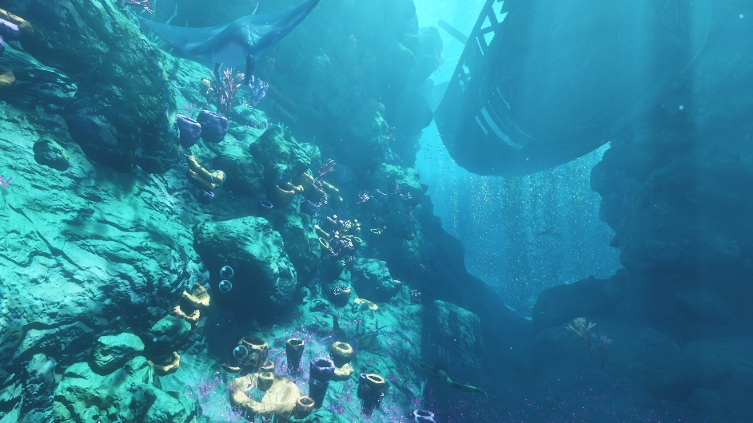
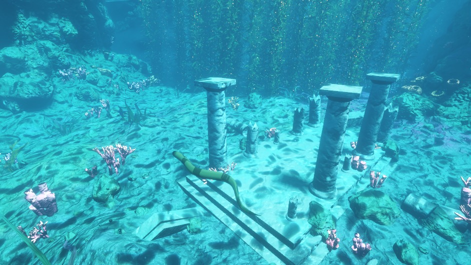

# 🐠 Abyssal Garden: head steering edition

**Swim through an underwater world by looking where you want to go.** Glide past a sunken ship, the ruins of Greek
temples, coral reefs and kelp forests, with whales, sharks, manta rays, sea turtles, eels and schools of fish.

**[Play Abyssal Garden](https://renegml.github.io/abyssal-garden/)** (a webcam, a mouse or the keyboard; nothing to
install. Needs a browser with WebGPU: current Chrome or Edge on a computer)

## How to play

Pick a ride in the menu:

- **Free swim:** the swimmer glides forward by itself. Turn your head **left or right** to turn, and tilt it **up or
  down** to swim up or down. If you swim into a wall and get stuck, the swimmer turns itself toward open water.
- **On rails:** the swimmer rides a set tour all by itself, past the shipwreck, the temples and six scenic spots,
  slowing down and turning toward each one. Your head only looks around. This is for players who find steering hard.

Then press **Steer with your head** (webcam), **Steer with the mouse** (the swimmer heads toward the pointer, or a
finger on a touch screen), or **Mouse look & keys** (WASD to swim, Q and E for down and up).

## Made for every player

This edition was made for a special education classroom, for students who play with small head movements, a mouse or
a few keys.

- **Head steering** runs on your own computer: no video is recorded or sent anywhere.
- **Settings to fit each player:** sensitivity, dead zone, swim speed, turn speed and smoothing, up and down on or off,
  and an optional big arrow that shows which way the swimmer is turning.
- **Keeps its aim:** "straight ahead" slowly follows a player who leans or shifts in their chair. Press **C** to
  re-centre.
- **A demo** tours the world by itself when nobody's there, and hands over as soon as a face is seen.
- **Detail levels** (Low, Medium, High) for slower computers. If the graphics crash twice in a row, the game starts
  again on the lowest settings.

## Credits

**[Abyssal Garden](https://github.com/Noniv/abyssal-garden)** is by Maksymilian Dendura (MIT license, see
[LICENSE](LICENSE)). The underwater world, its lighting and its sea life are his. This edition adds head steering,
the On rails ride, mouse steering, the demo, the stuck rescue, the Greek ruins, whales, sharks, eels and sea turtles.

Face tracking: MediaPipe Face Landmarker (Apache 2.0, in ./mediapipe).

## Running it yourself

Everything is in this folder: open `index.html` from any web server (the webcam needs https or localhost).
